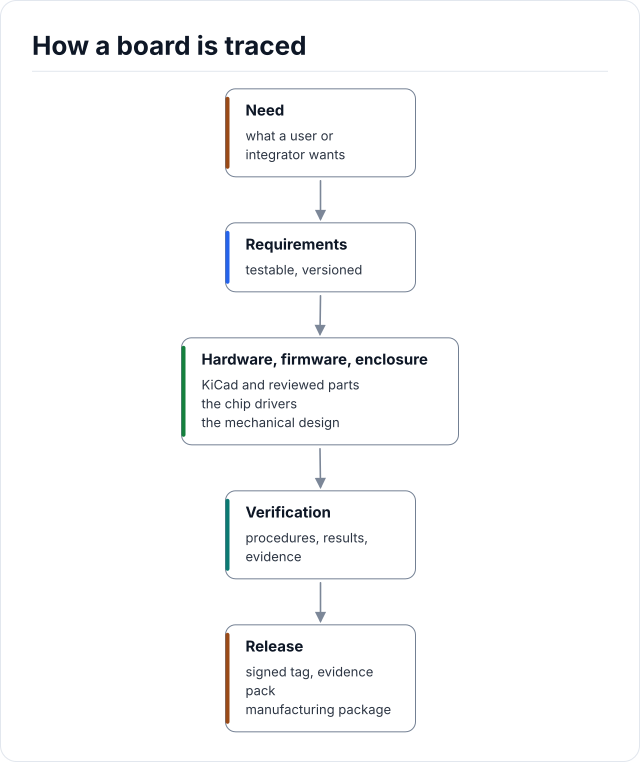

# Figures

<!-- Written by kokeb-docs figures from docs/diagrams/figures/*.py. Do not edit by hand. -->

Every figure on this site is drawn by a Python module from facts extracted from the code, so it is rebuilt,
not redrawn, when the code changes. CI runs `kokeb-docs figures --check` and fails when a
committed figure no longer matches the code. Each figure below lists the files it is drawn from.

## How a board is traced

<!-- figure: board-trace -->
<picture>
  <source media="(prefers-color-scheme: dark)" srcset="board-trace.dark.svg">
  
</picture>
<!-- /figure -->

Hardware description: [`docs/model/board-trace.graph.yml`](../model/board-trace.graph.yml)

Drawn from:

- [`docs/model/board-trace.graph.yml`](../model/board-trace.graph.yml)
