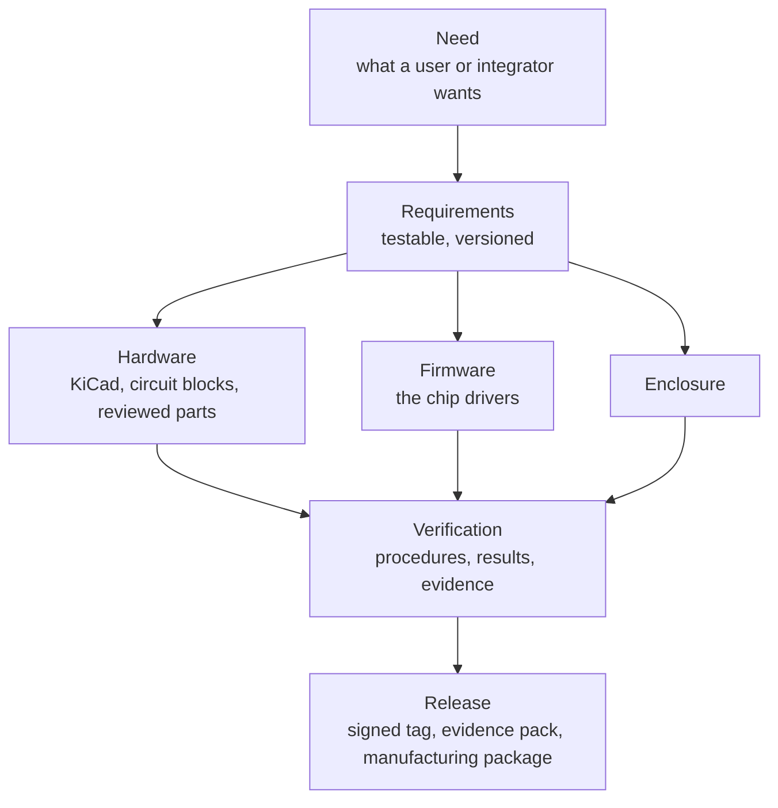

<picture>
  <source media="(prefers-color-scheme: dark)" srcset="https://raw.githubusercontent.com/kokeb-labs/.github/main/brand/mark/mark-dark.svg">
  
</picture>

# Kokeb Labs

Open embedded C++ for real hardware. We build the software between your firmware and the chips on your board:
C++20 chip drivers that never call a vendor SDK, a framework that joins them, and the tools and process that keep
them trustworthy. Give a driver a few small functions for your bus and the same code runs on ESP32, STM32, RP2040
or your laptop, where its tests run without hardware. MIT licensed.

*Kokeb (ኮከብ) means "star" in Amharic.*

**Portal: <https://kokeb-labs.github.io/>** · [Drivers](https://github.com/kokeb-labs-drivers) ·
[Handbook](https://kokeb-labs.github.io/handbook/) ·
[Request a driver](https://github.com/kokeb-labs-drivers/driver-requests)

## How the pieces fit

<picture>
  <source media="(prefers-color-scheme: dark)" srcset="https://kokeb-labs.github.io/diagrams/system-map.dark.svg">
  
</picture>

Your firmware calls a driver. The driver knows the chip and nothing about your MCU: it reaches the bus only through
the hooks of a port class, which is a short class you write. Beside that path sits the tooling lane: the templates
start a repository, `ci-tools` runs the same checks in all of them, the handbook says what those checks enforce, and
the request repository takes the asks for new drivers.

## What is here

Three organisations, every public repository MIT licensed.

| Where | Project | Role | Status |
| --- | --- | --- | --- |
| [kokeb-labs-drivers](https://github.com/kokeb-labs-drivers) | 22 chip drivers, `driver-<chip>` | One header-only C++20 library per chip, from ADCs and encoders to motor controllers. Each has a host example, an ESP32 example and a docs site | Release candidates, `v0.1.0-rc.1` |
| [kokeb-labs-drivers](https://github.com/kokeb-labs-drivers) | [`driver-requests`](https://github.com/kokeb-labs-drivers/driver-requests) | Ask for a driver, a port or a target, or report a datasheet erratum; requests move through the Driver pipeline board | Open |
| This organisation | [`driver-template`](https://github.com/kokeb-labs/driver-template) | Start a new driver or library: code, host tests, an ESP32 example, docs and CI from one command | Ready |
| This organisation | [`ci-tools`](https://github.com/kokeb-labs/ci-tools) | Reusable workflows and the documentation theme and figure kit every repository uses | v1 |
| This organisation | [`handbook`](https://github.com/kokeb-labs/handbook) | Every rule for C, C++, CMake, docs, CI and agents, each with the check that verifies it | Ready |
| This organisation | [`espidf-tools`](https://github.com/kokeb-labs/espidf-tools) | Build, flash and monitor every app of an ESP-IDF project from one `app_config.yml` | v1 |
| This organisation | [`board-template`](https://github.com/kokeb-labs/board-template) | Start a new board: record, requirements trace, checks and CI | Version 0 |
| [kokeb-labs-open-boards](https://github.com/kokeb-labs-open-boards) | [`board-bmp581-breakout`](https://github.com/kokeb-labs-open-boards/board-bmp581-breakout), [`kokeb-libs`](https://github.com/kokeb-labs-open-boards/kokeb-libs), [`kokeb-blocks`](https://github.com/kokeb-labs-open-boards/kokeb-blocks) | The first board, the KiCad parts library and the circuit blocks boards are made from | Concept |
| Not public yet | `kb-core` and the ESP32 and STM32 ports | The framework that joins drivers to interfaces, handlers and an RTOS layer, and the ports that implement the bus hooks | In development |

The [portal](https://kokeb-labs.github.io/projects/) lists every driver with its chip and bus.

## How we build

Drivers are built as if they could end up in a safety-classified product, and each says how far it has been checked.

| | |
| --- | --- |
| **MISRA C++:2023** | Every pull request runs the MISRA scan; each deviation is recorded with its reason |
| **Independent review** | A reviewer who did not write the driver reviews it in rounds, and breaks each fix on purpose with mutants |
| **Tested and fuzzed** | Host tests against a chip model written from the datasheet; a fuzzer corrupts the chip's replies; coverage and complexity gates |
| **Release candidates** | Every driver ships as a `-rc` tag first, with its hardware level stated |
| **Hardware validation levels** | H0 host model only, H1 bench rig run with logs kept, H2 signed off by a hardware engineer. All 22 drivers are at H0 today |
| **IEC 62304** | Built so a manufacturer can use a component in software of any safety class, Class C included. It is evidence for their process, not a certificate |
| **C++20 today** | Every driver is C++20 with extensions off. The standard will move up under a [stated policy](https://kokeb-labs.github.io/principles/#language-standard), not on a date |

Read the details on [How we build](https://kokeb-labs.github.io/principles/) and in the
[handbook](https://kokeb-labs.github.io/handbook/).

## Boards

Each board is traced from what people need down to the part on the board and its test results:

Requirements, risks and verifications are data linked by version. Change a need or a chip choice and every
requirement and test that depends on it is flagged in the same pull request. The format and the check live in
[`board-template`](https://github.com/kokeb-labs/board-template). The boards are early: nothing has been built or
verified on hardware yet.

## Get involved

| You want to | Go to |
| --- | --- |
| Use a driver | [The driver list](https://kokeb-labs.github.io/projects/#chip-drivers) |
| Ask for a chip that has no driver | [Request a driver](https://github.com/kokeb-labs-drivers/driver-requests/issues/new?template=request-driver.yml) with a link to the vendor's public datasheet; a thumbs-up on an existing request is a vote |
| Write a driver | Start from [`driver-template`](https://github.com/kokeb-labs/driver-template) |
| Learn the rules | The [engineering standard](https://github.com/kokeb-labs/.github/blob/main/standards/README.md) and the [handbook](https://kokeb-labs.github.io/handbook/) |
| Contribute a change | [Contributing](https://github.com/kokeb-labs/.github/blob/main/CONTRIBUTING.md): branches, commits, the DCO sign-off and the CI gate |
| Report a vulnerability | Privately, as the [security policy](https://github.com/kokeb-labs/.github/blob/main/SECURITY.md) says |
| Ask a question | [Discussions](https://github.com/kokeb-labs/.github/discussions) or [Support](https://github.com/kokeb-labs/.github/blob/main/SUPPORT.md) |

Never report a vulnerability in a public issue.
