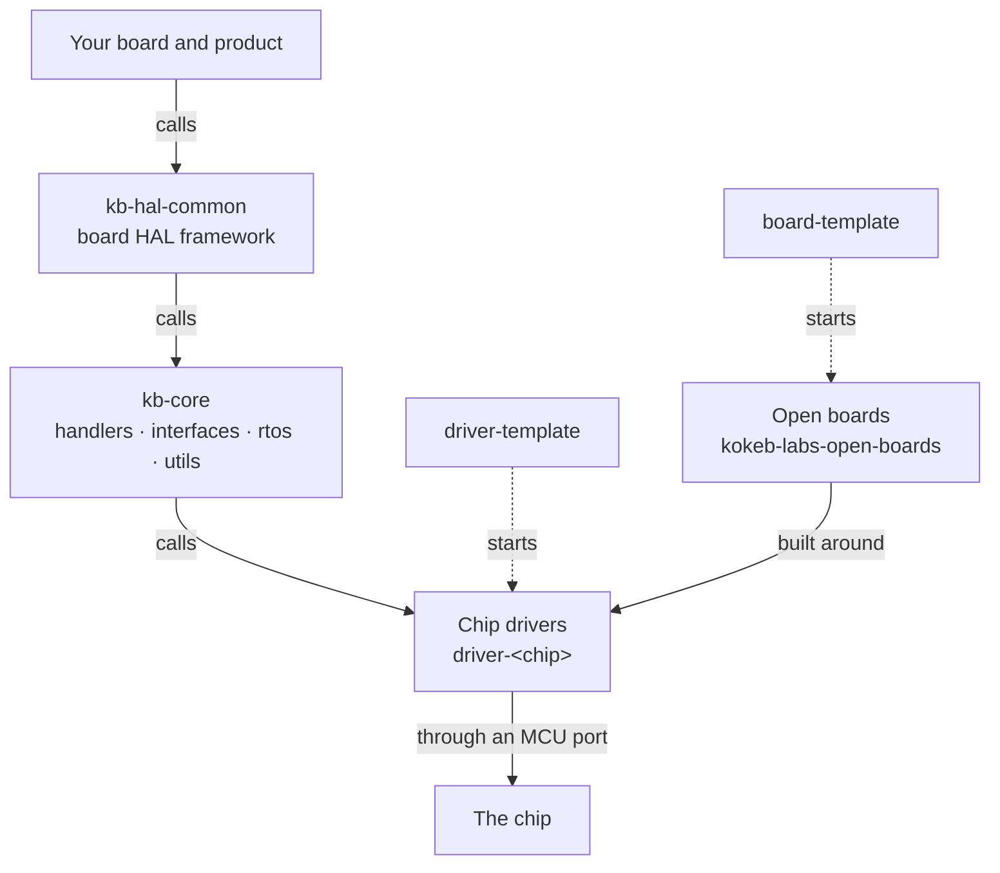
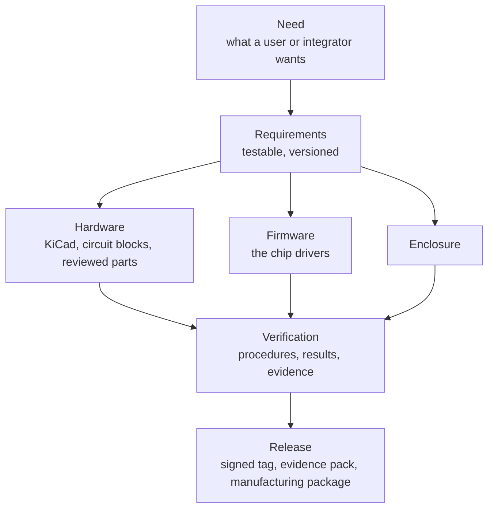

<picture>
  <source media="(prefers-color-scheme: dark)" srcset="https://raw.githubusercontent.com/kokeb-labs/.github/main/brand/mark/mark-dark.svg">
  
</picture>

# Kokeb Labs

Open embedded C++ for real hardware: chip drivers that run on any MCU, a portable core for ESP32, STM32 and the
host, and templates that get a new driver or board from zero to tested in minutes.

*Kokeb (ኮከብ) means "star" in Amharic.*

Each arrow is a call, from your product down to the chip:

Start at the portal: **<https://kokeb-labs.github.io/>**.

Each board is traced from what people need down to the part on the board and its test results:

Requirements, risks and verifications are data linked by version. Change a need or a chip choice and every
requirement and test that depends on it is flagged in the same pull request. The format and the check live in
[`board-template`](https://github.com/kokeb-labs/board-template).

## What is here

- **Chip drivers with no platform code.** Each `driver-<chip>` is a C++20 library that depends on nothing but
  the port you give it: a few bus functions for SPI, I2C, UART or ADC. Use one on its own, on any MCU.
- **kb-core.** MCU interfaces with ESP32, STM32 and host ports, a small RTOS layer (FreeRTOS, ThreadX or none),
  utilities and the handlers that join drivers to the interfaces. Pick your MCU, RTOS and drivers in one CMake
  file; only what you pick is built.
- **Templates.** [`driver-template`](https://github.com/kokeb-labs/driver-template) turns into a new driver or
  library with one command: code, host tests, an ESP32 example, docs and CI included.
- **Open boards.** [`kokeb-labs-open-boards`](https://github.com/kokeb-labs-open-boards) holds KiCad boards built
  around the drivers, the parts library and the circuit blocks they share. [`board-template`](https://github.com/kokeb-labs/board-template)
  starts a new board with its record, its requirements trace and its checks.
- **Shared CI and docs.** [`ci-tools`](https://github.com/kokeb-labs/ci-tools) holds the reusable workflows and the
  documentation theme every repository uses.

## Principles

- **Hardware-agnostic by construction.** Drivers never include MCU headers. MCU code lives in one folder per
  family, selected by the build. Board and product values arrive as configuration.
- **Tested off the hardware first.** Every driver and library runs its tests on the host in CI before it reaches a
  board.
- **No brand in your code.** A driver's namespace, CMake target and macros are named after the chip, so a fork
  never inherits our prefix.
- **MIT licensed.** Use it in open or closed products.

## Start here

| Page | What it covers |
| --- | --- |
| [Engineering standard](https://github.com/kokeb-labs/.github/blob/main/standards/README.md) | The rules every repository follows |
| [Contributing](https://github.com/kokeb-labs/.github/blob/main/CONTRIBUTING.md) | Branches, commits, the DCO sign-off and the CI gate |
| [Security policy](https://github.com/kokeb-labs/.github/blob/main/SECURITY.md) | How to report a vulnerability privately |
| [Support](https://github.com/kokeb-labs/.github/blob/main/SUPPORT.md) | Where to ask questions |

Questions and ideas go to [Discussions](https://github.com/orgs/kokeb-labs/discussions). Report vulnerabilities
privately, never in a public issue.
